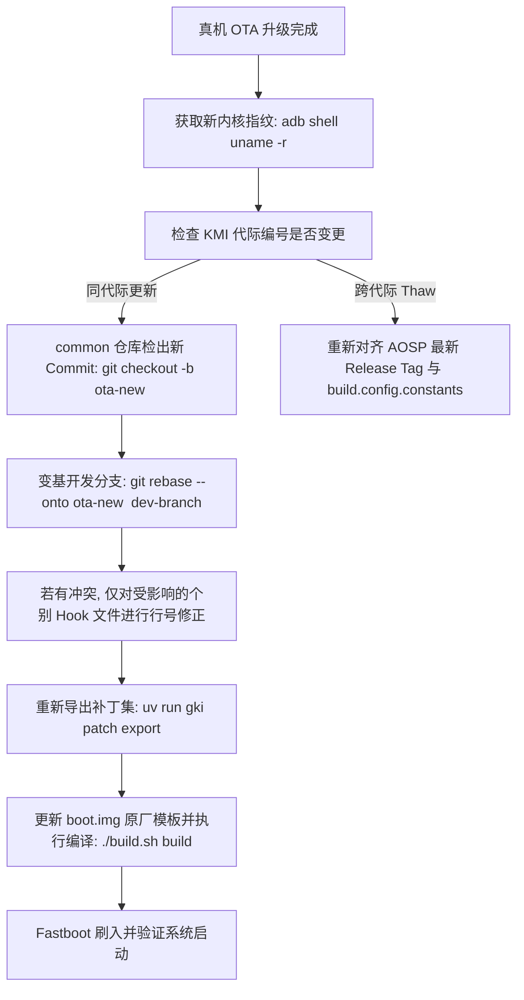

# Android GKI KMI 代际对齐与厂商 OTA 持续维护规范

本文档面向基于 Google AOSP GKI（Generic Kernel Image）进行内核定制（如 KernelSU、SuSFS、驱动签名绕过及网络拥塞控制调优）的开发者，详细阐述出厂内核版本指纹识别、KMI（Kernel Module Interface）与 `vermagic` 校验机制、厂商 OTA 升级后的分支变基（Rebase）流程，以及补丁集（Patches）的标准化生命周期管理。

---

## 1. 核心理论与机制

### 1.1 内核版本命名与 KMI 代际规范
在 Android 13+ 及 16 GKI 架构下，内核版本标识（Release String）采用严格的标准化结构：

```text
${VERSION}.${PATCHLEVEL}.${SUBLEVEL}-${BRANCH}-${KMI_GENERATION}-g${COMMIT}-${BUILD_ID}-${PAGE_SIZE}
```

以真实设备 OnePlus/OPPO（PLZ110）Android 16 运行环境为例：
```text
6.12.69-android16-6-g242e1a07f878-ab15865446-4k
```

各字段语义如下：
- `6.12.69`：Linux 内核主版本、次版本与上游补丁级别（Sublevel）；
- `android16-6`：AOSP 发行版代号及当前 KMI 代际编号（Generation 6）。由 `build.config.constants` 中的 `BRANCH` 与 `KMI_GENERATION` 定义；
- `g242e1a07f878`：AOSP `common` 源码仓库对应的 Git Commit Hash 前缀（对应官方 Tag `android16-6.12-2026-03_r54`）；
- `ab15865446`：Google 官方 Android Build 服务器的构建任务 ID；
- `4k`：ARM64 MMU 内存分页粒度（Page Size 4KB）。

### 1.2 内核模块加载与 `vermagic` 校验
Linux 内核加载外部模块（`vendor.ko`、`system_dlkm.ko`）时，通过 `kernel/module/main.c` 中的 `check_modinfo` 执行版本签名检查：
1. **字符串比对**：比对模块元数据中的 `vermagic` 与当前内核的 `VERMAGIC_STRING`；
2. **CRC 校验**：当启用 `CONFIG_MODVERSIONS=y` 时，`same_magic()` 会忽略第一段内核版本前缀，转而对符号导出表（Symbol CRCs）与 `module_layout` 进行严格哈希校验。

#### 为什么跨代际（KMI Thaw）会引发致命异常？
Google 在每个重大代际切换阶段（例如从 `android16-5` 递增至 `android16-6`）会解冻 KMI，结构体字段排布与函数签名会发生非兼容性重构。若将 `android16-6` 内核直接刷入仍处于 `android16-5` 固件的设备，厂商模块（如 `/vendor/lib/modules/oplus_secure_guard_new.ko`）将因 CRC 校验失败（`-ENOEXEC`）被系统拒绝加载，进而触发硬件看门狗复位并陷入循环重启。

---

## 2. 原厂 Boot 镜像模板归档体系

为了保证通过 Fastboot 直接刷入 `boot.img` 的便利性与稳定性，工程采用出厂 Boot 镜像解包重打包方案，避免破坏厂商专有的 `bootconfig`、AVB 页脚签名或 vendor 引导参数。

### 2.1 归档目录规范
原厂镜像统一存放在 `tools/boot_templates/<KMI>/` 目录下：

```text
tools/boot_templates/
└── android16-6.12/
    ├── stock_boot_PLZ110_17.0.0.107_6.12.69-android16-6-g242e1a07f878.img  # 完整命名归档
    └── boot.img -> stock_boot_PLZ110_17.0.0.107_6.12.69-android16-6-g242e1a07f878.img # 软链接供构建套件直接调用
```

命名规范：
```text
stock_boot_<DEVICE_MODEL>_<ROM_VERSION>_<KERNEL_RELEASE>.img
```

### 2.2 提取真机 Boot 分区
在设备连接并开启 root 权限的前提下，通过 ADB 提取当前活动的 Boot 槽位镜像：

```bash
# 1. 查询当前启动槽位
SLOT=$(adb shell getprop ro.boot.slot_suffix) # 输出 _a 或 _b

# 2. 定位并转储活动 boot 分区
adb shell "su -c 'dd if=/dev/block/by-name/boot${SLOT} of=/data/local/tmp/stock_boot.img bs=4M'"

# 3. 拉取至宿主机工程模板库
adb pull /data/local/tmp/stock_boot.img tools/boot_templates/android16-6.12/stock_boot_$(adb shell getprop ro.product.model)_$(adb shell getprop ro.build.display.id | tr ' ()/' '____')_$(adb shell uname -r).img

# 4. 建立统一符号链接
cd tools/boot_templates/android16-6.12/
ln -sf stock_boot_*.img boot.img

# 5. 清理手机端临时文件
adb shell "su -c 'rm /data/local/tmp/stock_boot.img'"
```

---

## 3. 补丁解耦与管理架构

为了杜绝过去将数百个源码文件合并进单一巨石补丁导致的升级脆弱性，工程将所有定制化能力划分为逻辑清晰的独立补丁集：

| 编号 | 补丁文件名 | 影响范围 | 变动频率与维护建议 |
| :---: | :--- | :--- | :--- |
| **0001** | `0001-kernel-configs-bypass-module-sig-protect-and-enable-network-configs.patch` | `kernel/module/main.c`<br>`kernel/module/signing.c`<br>`arch/arm64/configs/gki_defconfig` | **极低**。负责放行官方模块签名检查（兼容出厂 WiFi/蓝牙驱动），并启用 TTL/HL 网络目标。Google 若在 defconfig 原生合入某些网络宏，只需剔除重复宏即可。 |
| **0002** | `0002-feat-integrate-KernelSU-v3.3.0-and-SuSFS-2.3.0-in-tr.patch` | `drivers/kernelsu/`<br>`fs/susfs.c`<br>`fs/exec.c`<br>`fs/proc/` 等核心 VFS 与 SELinux 钩子 | **中等**。包含完整的 KernelSU 与 SuSFS 树内实现。当上游内核改动邻近头文件或循环结构时，需针对冲突文件执行单点行号微调。 |

---

## 4. 厂商 OTA 更新后的标准维护四步法

当手机系统接收到厂商 OTA 系统更新并升级后，按照以下工作流更新本地内核定制分支：



### 步骤 1：捕获新内核基线提交
在升级后的真机终端中执行：
```bash
adb shell uname -r
```
输出示例：
```text
6.12.69-android16-6-g242e1a07f878-ab15865446-4k
```
重点提取 Commit 前缀：`242e1a07f878`。

### 步骤 2：对齐 AOSP 提交基线并变基
进入外部内核源码仓库：
```bash
cd android16-6.12/common

# 确保远程 tag 已获取
git fetch aosp --tags

# 将当前工作分支变基到新提交基线上
git checkout 242e1a07f878
git rebase --onto 242e1a07f878 <OLD_COMMIT_HASH> <YOUR_WORK_BRANCH>
```

### 步骤 3：冲突化解要领
通常由于上游重构，冲突仅出现在以下 4 处关键挂钩点：
1. **`fs/exec.c` 与 `fs/proc/base.c`**：上游头文件增删（如 `#include <linux/dma-buf.h>`）导致 `#include <linux/susfs_def.h>` 上下文不匹配。保持 susfs 引用位于标准头文件下方即可；
2. **`fs/proc/task_mmu.c`**：函数重命名（如 `vma_pages()` 变更为 `vma_data_pages()`）或厂商 Vendor Hook 插入。确保 `SUSFS_IS_INODE_SUS_MAP` 检查处于遍历入口最前端；
3. **`security/selinux/hooks.c`**：KMI 兼容性全局变量声明位移。确保 `CONFIG_KSU_SUSFS` 外部声明放置于 `SECMARK` 前。

### 步骤 4：自动化同步与产物验证
冲突解决并完成本地 Commit 后，使用 CLI 工具一键同步至补丁集：

```bash
cd /home/pochita/project/android/gki

# 自动化导出工作分支的所有新 commit 至 patches/android16-6.12/
uv run gki patch export

# 提取新系统 boot 镜像并重置符号链接
# (按第 2 节规范操作)

# 编译并生成 Fastboot Boot 镜像
./build.sh build
```

编译产物将自动写入：`out/release/boot/boot_android16-6.12_*.img`，可通过以下命令一键刷入：
```bash
fastboot flash boot out/release/boot/boot-android16-6.12-latest.img
fastboot reboot
```

